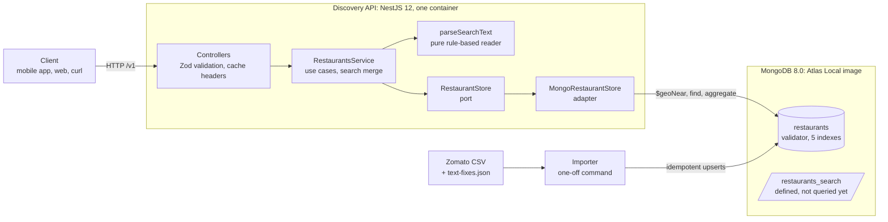

# BiteExpress restaurant discovery API

A restaurant-discovery service for a growing food-delivery platform, built on
MongoDB. It is my answer to the MongoDB Forward Deployed Architect take-home: an
MVP that is both a proof of concept and a proof of value for the customer-facing
"find me a restaurant" part of the app, and a foundation that more than one
business can share.

You can create a restaurant, fetch it, list and filter restaurants (by name, city,
cuisine, rating, cost, and distance from a point), and ask for them in plain
English: *"Best restaurants in Gurgaon with South Indian Food"*, *"Restaurants in
Gurgaon under Rs. 1000 for two"*, *"Nearest place that serves Vada Pav"*. Every
search answer says how the sentence was read, so nothing is guessed in silence.

Stack: Node.js 24, TypeScript, NestJS 12 (Express 5), Zod 4, the official MongoDB
driver, MongoDB 8.0 with Atlas Search (the `mongodb-atlas-local` image), Jest,
Docker Compose.

**Where to look first**

| If you want to... | Read |
| --- | --- |
| Run it and ask the three questions of the brief | [Quick start](#quick-start) and [Try it](#try-it) |
| See why it is built this way, and the migration, scale and compliance story | [docs/DECISIONS.md](docs/DECISIONS.md) |
| Run any task (load data, look inside MongoDB, every kind of test, troubleshooting) | [docs/RUNBOOK.md](docs/RUNBOOK.md) |
| See how AI was used | [AI and resources disclosure](#ai-and-resources-disclosure) and [docs/AI_USAGE.md](docs/AI_USAGE.md) |

## What is built, and what is only described

I treated the brief as an architecture exercise with a working slice, so this
README is explicit about which is which.

| Built and tested | Described in [DECISIONS.md](docs/DECISIONS.md), not built |
| --- | --- |
| `POST /v1/restaurants`, `GET /v1/restaurants/{id}`, `GET /v1/restaurants`, `GET /v1/restaurants/search` | Moving off the monolith: phases, data flow, validation, rollback |
| Natural-language search by fixed rules, with an `interpretation` block in every answer | Peak-hour hardening beyond indexes: query time limits, circuit breaker, rate limiting, edge cache, read replicas |
| An importer that cleans the Zomato CSV and loads it repeatably | International expansion: data residency, regulation, encryption |
| One collection, a database-side validator, five indexes, `$geoNear` | Authentication (today the tenant comes from a demo header) |
| Multi-tenancy in the data model, every index and every query | Querying the Atlas Search index (it is defined and created, but no endpoint uses it yet) |
| Unit, HTTP and real-MongoDB integration tests; a query-plan check | Continuous integration, a load test, an OpenAPI file |
| Docker Compose: MongoDB, the API, and the importer job | |

## Quick start

You need Docker with Compose v2 (Docker Desktop is fine) and about 2 GB of free
memory. Ports 3000 and 27017 are used on `127.0.0.1` only. You do **not** need
Node.js for this path.

```bash
git clone https://github.com/<your-account>/biteexpress-discovery.git   # [CONFIRM: put the real repository URL here]
cd biteexpress-discovery

# 1. Start MongoDB (Atlas Local) and the API. The first run downloads the image: a few minutes.
docker compose up -d --build --wait --wait-timeout 300

# 2. Load the 500-restaurant sample (a one-off job). It ends with "Result: PASS".
docker compose run --rm --build importer

# 3. Ask a question
curl -G http://localhost:3000/v1/restaurants/search --data-urlencode "q=Restaurants in Gurgaon under Rs. 1000 for two" -d limit=3
```

On Windows PowerShell, type `curl.exe` instead of `curl`: PowerShell's `curl` is a
different command. The JSON comes back on one line; pipe it to `jq` if you have
it, or in PowerShell to `ConvertFrom-Json | ConvertTo-Json -Depth 6`.

Check that it is healthy: `curl http://localhost:3000/ready` answers `200` with the
state of MongoDB, the indexes and the search index. Stop everything with
`docker compose down` (the data stays in Docker volumes) or `docker compose down -v`
(deletes the data too).

**Working on the code** needs Node.js 24.9 or newer:

```bash
npm install
npm run db:up        # MongoDB only, in Docker
npm run import       # load the sample (add -- --file data/full/zomato.csv for the full file)
npm run start:dev    # the API on http://localhost:3000, restarting when you save a file
npm run check        # lint, type-check, unit tests and HTTP tests (no database needed)
```

[docs/RUNBOOK.md](docs/RUNBOOK.md) has every command, what it prints, how to
change ports or use Atlas instead of Docker, and a troubleshooting table.

## Try it

These are the three questions of the brief. The repository carries a 500-row
sample so it starts from a plain clone; the full file (9,551 restaurants) is not
in Git (see [Data](#data)). The sample is small, so two of the three questions
find little in it. The table shows both, so you know what to expect.

```bash
# "Best restaurants in Gurgaon with South Indian Food"
curl -G http://localhost:3000/v1/restaurants/search --data-urlencode "q=Best restaurants in Gurgaon with South Indian Food"

# "Restaurants in Gurgaon under Rs. 1000 for two"
curl -G http://localhost:3000/v1/restaurants/search --data-urlencode "q=Restaurants in Gurgaon under Rs. 1000 for two"

# "Nearest place that serves Vada Pav" - a sentence cannot say where you are, so pass
# your position; this is Cyber Hub, Gurugram
curl -G http://localhost:3000/v1/restaurants/search --data-urlencode "q=Nearest place that serves Vada Pav" -d lat=28.495 -d lng=77.089
```

| Question | Read as | 500-row sample | Full dataset |
| --- | --- | --- | --- |
| Best restaurants in Gurgaon with South Indian Food | cuisine South Indian, city Gurgaon, best rated first | 1 match (RD's Authentic Aroma, which has no rating) | 70 matches; the first three are Zambar, Bikanervala, Khaaja Chowk |
| Restaurants in Gurgaon under Rs. 1000 for two | city Gurgaon, cost for two at most 999 INR, best rated first | 35 matches | 893 matches; the first three are Caterspoint, Twigly, Cafe Gatherings |
| Nearest place that serves Vada Pav (from Cyber Hub) | the words "vada" and "pav" in the name or area, nearest first | none; a note says so | 16 with a location; the nearest is Goli Vada Pav No. 1 (DLF Phase 3) at 0.47 km, then two more at 3.94 and 3.96 km |

**Vada Pav is a good example of an honest limit.** The Zomato file lists
cuisines but no menu items, so no system built on it can know who sells vada pav.
The API says exactly that, and does the next best thing: it looks for the words in
restaurant names and areas. The answer carries this note:

```json
"interpretation": {
  "q": "Nearest place that serves Vada Pav",
  "summary": "Restaurants with \"vada pav\" in the name or area, nearest first",
  "filters": { "sort": "distance" },
  "words": ["vada", "pav"],
  "overridden": [],
  "notes": ["\"vada\", \"pav\" are not a city, country, cuisine or filter, so each word must appear in a restaurant's name or area. The data has no menu items to search."]
}
```

Some more sentences to try (add `-d lat=28.495 -d lng=77.089` to the ones that say
"near", "nearest" or give a distance):

```text
Nearest Italian restaurant                       the closest Italian place, wherever it is
top 5 italian places near me                     the 5 best rated Italian restaurants within 5 km
pizza rated above 4 within 3 km                  a rating and a distance
restaurants in Dubai under 150 dirhams           another country and currency
cheap street food nearby                         cheapest first, within 5 km
```

For a live demo I would load the full file first (see [Data](#data)); the same
commands then show the right-hand column of the table.

## API

Everything is under `/v1`. The probes `/health` and `/ready` are outside it.

| Method and path | What it does |
| --- | --- |
| `POST /v1/restaurants` | Creates a restaurant and returns it (`201`, with a `Location` header). The body is strict: a field the contract does not name is a `400`. The server owns the tenant, currency, rating label and score, status and timestamps. A source id the tenant already has is a `409`. Examples are in `docs/examples/`. |
| `GET /v1/restaurants/{id}` | The complete restaurant: address, coordinates, cuisines, cost, rating, services, status, data-quality flags. `ETag` and `Cache-Control: private, max-age=30`. A malformed id is a `400`; an unknown id, or another tenant's, is a `404`. |
| `GET /v1/restaurants` | One page of restaurants, filtered and sorted. Each item has the attributes the brief asks for (see below). |
| `GET /v1/restaurants/search` | Everything the list does, plus `q`: a sentence read into the list's own parameters. The answer is the list's answer plus an `interpretation` block. |
| `GET /health` | Liveness: is the process alive? Never touches MongoDB. |
| `GET /ready` | Readiness: can it serve traffic? `200` when MongoDB answers and all five indexes exist, otherwise `503` with the reasons. Also reports the Atlas Search index. |

**List and search parameters.** All optional; an unknown one is a `400`, never
ignored.

| Parameter | Meaning |
| --- | --- |
| `name` | The name contains this text (case-insensitive, taken literally) |
| `city` | Case-insensitive; other names are understood (`Gurugram` for `Gurgaon`, `Bengaluru` for `Bangalore`) |
| `country` | A name or an ISO code: `India`, `IN`, `UK`, `USA` |
| `cuisine` | One or several (`cuisine=Thai,Chinese`); any of them matches, `cuisineMatch=all` requires all |
| `minRating` | The plain average rating is at least this (0 to 5) |
| `minCost`, `maxCost`, `currency` | Average cost for two between these, in one currency (there is no conversion) |
| `priceRange` | Zomato's band, 1 to 4 |
| `delivery`, `booking` | Offers online delivery / table booking |
| `lat`, `lng` | Measure distance from this point; both or neither. Every item then has `distanceKm` |
| `radiusKm` | Only within this distance (more than 0, at most 50); needs `lat` and `lng` |
| `sort`, `order` | `rating` (default), `distance` (default when a point is given), `averageRating`, `votes`, `cost`, `name`, `city`; `order` reverses it |
| `limit`, `offset` | Page size 1 to 50 (default 20); offset 0 to 1000 |
| `q` (search only) | A sentence of at most 200 characters |

**The response** has the brief's attributes. `Average Rating` is `averageRating`
and `Distance` is `distanceKm`, in camelCase.

```json
{
  "data": [
    {
      "id": "65a1b2c3d4e5f60718293a4b",
      "name": "Cherry Comet",
      "address": "K-5/A, Near Building 8-B Entrance, Cyber hub, DLF Cyber City, Gurgaon",
      "locality": "Cyber Hub, DLF Cyber City",
      "city": "Gurgaon",
      "country": "India",
      "countryCode": "IN",
      "cuisines": ["Ice Cream", "Desserts"],
      "averageRating": 3.6,
      "votes": 455,
      "costForTwo": 400,
      "currency": "INR",
      "distanceKm": 0.04
    }
  ],
  "page": { "limit": 1, "offset": 0, "hasMore": true },
  "meta": { "sort": "distance", "order": "asc", "tookMs": 3 }
}
```

`averageRating` is `null` when nobody has rated the restaurant: "not rated" is not
"rated zero". There is no total count on purpose; `hasMore` says whether to offer
another page (see [D7 in DECISIONS.md](docs/DECISIONS.md)).

**Every error has one shape**, RFC 9457 `application/problem+json`, with the
`requestId` of the call, one entry per faulty field, and `Cache-Control: no-store`:

```json
{
  "type": "/problems/validation-error",
  "title": "Validation failed",
  "status": 400,
  "detail": "The request is not valid. See errors for each field.",
  "instance": "/v1/restaurants",
  "requestId": "5d1c7f0e-61a4-4f43-9a0e-3a9d2b7e1c55",
  "errors": [
    { "parameter": "limit", "detail": "must be between 1 and 50" },
    { "parameter": "colour", "detail": "Unknown parameter \"colour\". Remove it." }
  ]
}
```

**Tenant.** Every query is scoped to one tenant. For this MVP the tenant is the
`X-Tenant-Id` header, or the default `biteexpress`. That header is a **demo** of
the boundary, not security: in production the tenant must come from the caller's
verified credential. The reasoning is in [D3](docs/DECISIONS.md).

The sentence grammar (what "under", "near me", "top 5", "cheapest" mean), the
rules for combining a sentence with parameters, and a `curl` example for every
refusal are in [RUNBOOK sections 3.14 to 3.16](docs/RUNBOOK.md).

## Architecture



The API is stateless; MongoDB holds the state. The importer is a separate command
with no HTTP surface, so a bad import cannot take the API down. The service talks
to a `RestaurantStore` interface: production uses the MongoDB adapter, and the
tests also use an independently written in-memory one, with the same contract
tests run against both.

**Decisions at a glance.** Each has a longer entry (context, choice, trade-off, when
I would revisit it) in [docs/DECISIONS.md](docs/DECISIONS.md).

| # | Decision | Trade-off I accepted |
| --- | --- | --- |
| D1 | One collection, one document per restaurant, shaped the way it is read | Reviews and menus will need their own collections when they exist |
| D2 | The official driver, no ODM | More hand-written queries; the `$geoNear` stage stays visible |
| D3 | Shared collection, `tenantId` on every document, index and query | Isolation is enforced in application code, not by the database |
| D4 | Five indexes, each for a named query shape, all leading with `tenantId` | Writes maintain five indexes; one shape sorts in memory |
| D5 | The database measures distance with `$geoNear` | Restaurants without coordinates can never be "near" anything |
| D6 | "Best" is a weighted score computed when a restaurant is written | A change to the formula needs a backfill |
| D7 | Offset paging with a cap, `hasMore` instead of a total | No "page 500 of 900"; keyset paging is the next step |
| D8 | Missing is not zero: unrated and unpriced restaurants sort last or are left out | A little more query logic |
| D9 | A cost is compared only inside one currency | No conversion, so no cross-currency questions |
| D10 | A search sentence is read by fixed rules, and the reading is shown | Understands only the phrases it has rules for |
| D11 | The search is the list: a sentence becomes the list's parameters | A sentence can never ask for more than the parameters can |
| D12 | The Atlas Search index is defined but nothing queries it yet | No typo tolerance or relevance ranking yet |
| D13 | Strict validation twice (Zod, then a database validator) and one error format (RFC 9457) | Services throw exceptions that carry HTTP meaning |
| D14 | Storage behind a port, with an independent fake and shared contract tests | More test code to maintain |
| D15 | The importer upserts on tenant + source id and keeps bad data visible | `updatedAt` moves on every rerun |
| D16 | A short private cache and an ETag; errors are never cached | A new restaurant can be missing for up to 15 seconds |
| D17 | `/health` and `/ready` are different questions; the app fails fast at startup | The API needs the right to create indexes (a migration job in production) |

D18 to D20 (the local stack, the names in the response, and what is logged) are in
the same document.

## Data

**Source.** The Zomato restaurants CSV that the brief links (Kaggle, "Zomato
Restaurants Data"), 9,551 rows in 15 countries (8,652 in India). The repository
holds a 500-row sample (`data/sample/zomato-sample.csv`, chosen with a fixed seed so
it always has the same rows, and including every awkward kind of row). The full
file and the Zomato API dumps that came in the same archive stay in `data/full/`,
which Git ignores. **Never commit the dumps: every record in them carries a Zomato
API key.** I could not confirm the licence of the Kaggle dataset, so I only
publish the small excerpt that the demo and the tests need. `[CONFIRM: check the
licence on the dataset's Kaggle page and edit this sentence to say what it permits]`

**To use the full file**, unzip the archive so that `data/full/zomato.csv` exists, then:

```bash
docker compose run --rm importer --file data/full/zomato.csv     # or: npm run import -- --file data/full/zomato.csv
```

Run it twice if you like: the second run reports `inserted 0, matched 9,551`.

**What the importer fixes**, because the raw file cannot be loaded as it is:

| Problem in the CSV | What the importer does |
| --- | --- |
| 500 rows have no usable position (497 at exactly 0, 0; 2 with one coordinate 0; 1 Indian row outside India) | Keeps the restaurant, stores no `location`, adds the flag `coords_missing`. No distance query returns it |
| 2,148 rows have rating 0, meaning "not rated" | Stores no average, label or score, so they never rank as "worst" |
| Cost 0 means "unknown" (18 rows) | Stores `null` |
| 166 names, addresses, cities and localities are damaged (a Latin-1 encoding problem: `Cafí© Daniel Briand`) | Replaces them from `data/text-fixes.json`, built once from the Zomato API dumps and keyed by restaurant id, and adds `text_repaired`. It never guesses a repair |
| Line breaks and runs of spaces inside addresses, duplicated cuisines | Collapses and de-duplicates |
| Two wrong country names in the country workbook | Corrected in `src/importer/countries.ts` |

Currencies differ by country (rupees, dirhams, pula...), so a cost is stored with
its currency and compared only within one. Nothing is deleted or edited in the
CSV; cleaning happens on the way in. For the full file the import report ends with
"Checks against the full dataset", so a changed rule or a truncated file fails
loudly. **Known limits:** no menu or dish data, 500 restaurants without
coordinates, no opening hours, and the image URL, menu URL and zip code in the
dumps are not imported ([data/README.md](data/README.md) explains why).

## MongoDB usage

**The document.** One collection, `restaurants`, one document per restaurant. This
is a real restaurant after cleaning (the importer adds `tenantId`, `createdAt` and
`updatedAt`):

```json
{
  "tenantId": "biteexpress",
  "schemaVersion": 1,
  "source": { "system": "zomato", "id": "308022" },
  "name": "Farzi Cafe",
  "address": {
    "line": "7-8, Ground Floor, Cyber Hub, DLF Cyber City, Gurgaon",
    "locality": "Cyber Hub, DLF Cyber City",
    "city": "Gurgaon",
    "country": { "code": "IN", "name": "India" }
  },
  "location": { "type": "Point", "coordinates": [77.0886879, 28.4952079] },
  "cuisines": ["Modern Indian"],
  "cost": { "forTwo": 2200, "currency": "INR", "priceRange": 4 },
  "rating": { "average": 4.3, "votes": 4385, "label": "Very Good", "score": 4.2903 },
  "services": { "tableBooking": false, "onlineDelivery": false, "deliveringNow": false },
  "status": "active",
  "dataQuality": []
}
```

`source` is the restaurant's identity in the system it came from: it makes imports
repeatable now and is the crosswalk to the legacy databases later.
`schemaVersion` lets the shape evolve without a big-bang migration. The
`$jsonSchema` validator (`validationLevel: strict`, `validationAction: error`)
states what must always be true and allows extra fields, so a newer version of the
service can add an optional field while an older one still runs. `npm run
db:validator-demo` shows the database refusing bad documents.

**Indexes.** `tenantId` leads every index, so one tenant's query never walks
another's entries. The compound ones follow equality, then sort, then range.

| Index | Keys | What it serves |
| --- | --- | --- |
| `tenant_location_2dsphere` | `tenantId`, `location` (2dsphere) | `$geoNear`: nearest first, and "within N km" |
| `tenant_city_score` | `tenantId`, `address.city`, `rating.score` desc, `_id` | A city, best first; `_id` makes paging stable when scores tie |
| `tenant_city_cuisine_score` | `tenantId`, `address.city`, `cuisines`, `rating.score` desc | A city plus a cuisine (multikey on the cuisine array) |
| `tenant_score` | `tenantId`, `rating.score` desc, `_id` | The default list and any filter without a city: MongoDB reads it in order and stops when the page is full |
| `tenant_source_unique` | `tenantId`, `source.system`, `source.id` (unique, partial) | Repeatable imports, duplicate refusal on create, lookup by legacy id |

**Distance.** `$geoNear` is the first stage of the pipeline, with the tenant and
every filter in its `query` option, so MongoDB returns restaurants nearest first
with the distance already computed and stops after one page. The application never
loads restaurants to measure them.

**Query plans are checked, not assumed.** `npm run db:explain` asks MongoDB for the
plan of 18 typical queries (a city, a city and a cuisine, a country, a rating, a part
of a name, nearest first, within 3 km, the words of a sentence, and the two lookups
of cities and cuisines) and prints `PASS` or `FAIL` for each: a `FAIL` means a
collection scan. The integration tests run the same check on the real queries,
so a new filter that stops using its index fails a test. I have not committed a
saved copy of the output; run it to see the plans. Two shapes are known and
accepted: a city plus a cuisine sorts its matches in memory (a city's worth of
restaurants), and the words of a sentence are matched as unanchored substrings, so
only the tenant prefix narrows the scan. Both are fine at 9,551 restaurants; at
millions, the second is what Atlas Search is for.

**Atlas Search.** The service creates an index, `restaurants_search`, at startup
(autocomplete on name and locality, exact tokens for tenant, status, city and
cuisine, numbers for rating and price, and geo), and `/ready` reports whether it is
queryable. **No endpoint queries it yet.** The search endpoint works on any MongoDB
with the ordinary indexes, and I chose to finish the documentation rather than add
a second query path; the upgrade path and why it is safe are in
[D12](docs/DECISIONS.md).

## Testing

| Command | Needs | What it proves |
| --- | --- | --- |
| `npm test` | nothing | About 1,000 unit tests: every cleaning rule of the importer; the request schemas, the error format and the service; the listing rules and the MongoDB query builder; the search reader (about 180 tests on phrases alone) and its merge with the parameters; and the contract checks run on the in-memory store |
| `npm run test:e2e` | nothing | The real Nest app over HTTP with MongoDB faked: routes, status codes, headers, create, fetch, list and search (the three questions of the brief, a sentence with parameters), and the error answer of every refusal |
| `npm run test:int` | `npm run db:up` | What only a real server can prove: validator rejections, the indexes, repeatable bootstrap, unique and partial index behaviour, `$geoNear` order and distances, the plans of the listing queries (no collection scan), the importer end to end (the sample twice leaves 500 documents; with the full file in `data/full/`, 9,551), and the contract checks again on the MongoDB store |
| `npm run check` | nothing | Lint (oxlint), type-check, `npm test` and `npm run test:e2e`, stopping at the first failure |

The integration tests create a throwaway database named `biteexpress_it_<random>`
and drop it afterwards, so the data you loaded is never touched.

Three design choices make the tests meaningful rather than numerous:

- The in-memory store was written independently of the MongoDB query builder, and
  one **contract** is run against both. If the MongoDB store disagrees with the
  oracle, a test fails.
- Query parameters are tested against operator injection (`?city[$ne]=x` is a
  `400`), and the tenant boundary is tested: another tenant's id is a `404`.
- The search is tested against the list: for a set of sentences (the brief's
  among them), the answer equals what the list returns for
  `interpretation.filters`.

**What the tests do not cover.** There is no load or performance test: the plans
are checked, the throughput is not measured. No continuous-integration pipeline is
set up, so nothing runs the suites automatically. The HTTP tests use a fake
database; real-database behaviour is covered only by the integration tests, which
need Docker. Search quality (relevance) is not evaluated; the reader is checked
phrase by phrase. There are no tests for authentication because there is none.

Last full run on my machine: `[CONFIRM: date, operating system, Docker version, and
the results of npm run check, npm run test:int, npm run import (Result: PASS) and
npm run db:explain (Result: PASS)]`

## Coexistence, scale, security and compliance

The long version, with the reasoning, the sources and what I could not verify, is
in [docs/DECISIONS.md](docs/DECISIONS.md) (sections 4 to 8). In short:

- **Coexistence.** Discovery is a read model that can be rebuilt from the system of
  record, which makes the move reversible. Four phases (strangler pattern):
  (1) read model, fed one way from the relational databases by a snapshot and then
  change data capture; (2) shadow traffic, then a canary by city starting with the
  NCR; (3) move the writes, with a reverse sync for modules that still read the old
  tables, one owner per entity at a time; (4) the next slices. The gateway routes
  back at every step. No dual writes from application code. `source.system` and
  `source.id` plus the unique index are the crosswalk, and they already make
  repeated loads idempotent.
- **Peak hours.** Cheapest lever first: indexes, projections and bounded pages
  (built), short private caching and ETags (built), then query time limits and a
  circuit breaker, a CDN cache keyed on a coarse location grid, read replicas and
  dedicated Search Nodes, and only then sharding, which is for data residency
  rather than for size. Sizing by method, not by guess, is in the decisions
  document.
- **Security.** Built: strict input validation, no way for a client to inject a
  MongoDB operator, an escaped name filter, tenant scoping in every query, secrets
  kept out of Git and out of error messages, no stack traces to clients, ports on
  `127.0.0.1`, a non-root container. Not built: authentication and authorization,
  rate limiting, security headers, TLS (terminated in front of the service in
  production).
- **Compliance and expansion.** Restaurant listings are public business data. The
  sensitive data is about people (customers, delivery partners, a caller's precise
  location), and it stays out of discovery documents; the access log omits the
  query string, so coordinates are not logged. For residency there are two
  options, Atlas Global Clusters (zone sharding by country) or one cluster per
  jurisdiction, and DECISIONS.md explains why I would start with the second and
  names one thing in this schema that would have to change for the first.

## Assumptions, cuts and next steps

**Assumptions** (all easy to change):

- All 15 countries are imported with no hidden default filter; the demo uses the
  NCR cities, and a country filter works like any other.
- Distance is in kilometres; callers pass `lat` and `lng` as query parameters.
- A cost is compared only inside one currency; there is no conversion.
- No authentication in the MVP. Payments, ordering and delivery are out of scope:
  this is the discovery read path.
- Data is cleaned at import; the raw CSV is never edited.
- The search must work offline and without keys, so no external LLM or embedding
  service is called.

**What I cut, and why.** The brief estimates 3 to 5 hours and values judgment under
time constraints; I spent more on the depth of the slice and the documents than on
breadth.

- Querying the Atlas Search index (typo tolerance, relevance, autocomplete), with
  the rule-based path as the fallback.
- Continuous integration (a workflow that runs the suites on every push) and a
  one-command `test:all`.
- A load test and a committed copy of the query plans.
- Update and delete endpoints, a by-source lookup, lists of cities and cuisines as
  endpoints, facets.
- An OpenAPI file, authentication, rate limiting, query time limits.

**Two more weeks would buy**, in this order: authentication with the tenant taken
from the credential; time limits, a circuit breaker and a rate limit; the Atlas
Search path with the rule-based one as its fallback; CI and a load test with
saved results; keyset paging; a working sync prototype (Debezium and the Kafka
connector into a staging cluster); a menu collection, which is what would let
"vada pav" be found as a dish.

## AI and resources disclosure

The brief asks for any resources beyond the obvious to be disclosed, and for the
work to be mine to explain and defend. This is what is true:

- **Tool.** I used Claude (Anthropic), through Claude Code, as a pair of hands for
  most of the work: analysing the brief and the dataset, writing the project plan,
  drafting and revising the code, the tests, the importer, the scripts and the
  documents in this repository. Sessions and decisions are logged in
  [docs/AI_USAGE.md](docs/AI_USAGE.md).
- **What I decided.** The stack (Node.js, TypeScript, NestJS, Jest, Zod, Docker
  Compose with the Atlas Local image), the scope and the order of work (for example
  to build search before the test-tooling and CI step, and to leave that step for
  last), and what to submit. `[CONFIRM: add what you personally wrote, rewrote or
  rejected, in your own words, for example the index definitions, the query
  builder, the parser rules]`
- **How the AI's work was checked.** The assistant could not run Docker or Jest in
  its environment, so it ran the logic with its own test runner and a stand-in for
  the HTTP layer, and I ran the real thing on my machine: `[CONFIRM: say which of
  npm run check, npm run test:int, npm run import and npm run db:explain you ran,
  and what you saw]`. Tests also found defects in the assistant's own output,
  which were then fixed: for example "top 5 italian places near me" first returned
  the five best Italian restaurants anywhere in the world, thousands of kilometres
  away, until "near me" was given a 5 km radius.
- **Things I changed or rejected.** `[CONFIRM: one or two concrete examples where
  you disagreed with the output or fixed it]`
- **Other resources.** MongoDB documentation, read by the assistant on my behalf to
  check the architecture claims, with the pages listed under "Sources" in
  [docs/DECISIONS.md](docs/DECISIONS.md); the Kaggle dataset linked in the brief.
  The search sentences are read by fixed rules; no language model or external
  service is used at runtime.

## Project layout

```text
docker-compose.yml, Dockerfile   MongoDB (Atlas Local), the API, and the importer job
src/
  config/       the settings, validated at boot (Zod)
  database/     the collection definition (validator, indexes, search index) and its repeatable bootstrap
  health/       /health and /ready
  http/         the shared HTTP layer: error format (RFC 9457), request ids and access log, tenant, validation pipe
  restaurants/  the resource: schemas, service, store port and MongoDB adapter, query builder, search reader
  importer/     the CSV importer: cleaning rules, upserts, report, command line
test/           HTTP tests, integration tests, and test/support (fake database, in-memory store, contract)
data/           the 500-row sample and the text fixes; data/full/ is for the full file and is ignored by Git
docs/           DECISIONS.md, RUNBOOK.md, request examples
scripts/mongosh/  inspect, validator demo and query-plan check, run inside the database container
```

`restaurants.controller.ts` is the HTTP glue, `restaurants.service.ts` the use
cases, `search-text.ts` the sentence reader, `search-query.ts` the merge with the
parameters, `mongo-list-query.ts` the query builder (a pure function, so it is
tested without a database), and `restaurant.list-item.ts` the one place that names
the response attributes.

**Conventions.** Conventional Commits (`feat:`, `fix:`, `test:`, `docs:`,
`chore:`), formatting with Prettier (`npm run format`), linting with oxlint
(`npm run lint`). No open-source licence is granted (`package.json` says
`UNLICENSED`); the code is public for the assessment.
