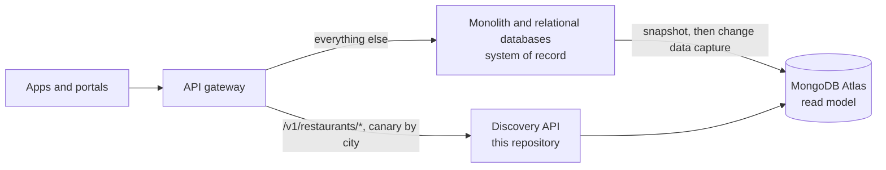

# Design decisions

Why the BiteExpress discovery API is built the way it is: what I chose, what it costs, and,
for what a three-to-five-hour MVP cannot hold, how I would do it. Commands are in the
[README](../README.md) and the [RUNBOOK](RUNBOOK.md); this file is the reasoning.

## 1. How to read this document

Every claim has one label: **Built** (in this repository, with tests), **Described** (a
design I can defend, not built) or **Open** (I could not verify it; section 12). Figures are
illustrative unless marked as measured. External facts come from pages I read on 1 November
2026 (section 13). Legal points are an architect's map, not legal advice.

| Built and tested | Only described |
| --- | --- |
| Create, get, list and search endpoints | Moving off the monolith (section 5) |
| One shared collection; the tenant in every document, index and query | Peak-hour hardening beyond indexes (section 6) |
| Five indexes, checked by query plan; `$geoNear` for distance | Authentication and rate limits (section 7) |
| A rule-based sentence reader that shows how it read the sentence | Residency, regulation, encryption (section 8) |
| Strict validation, one error format, `/health` and `/ready` | Querying the Atlas Search index (D12) |
| A repeatable importer: 9,551 rows in, 9,551 documents out | CI, a load test, an OpenAPI file (section 11) |
| Docker Compose: MongoDB, the API and the importer | |

## 2. The brief, and how I read it

BiteExpress is a food-delivery platform in India, on a multi-instance monolith with
relational databases, on premises in Gurugram. **Now** (6 to 12 months): reliability and
performance at peak hours. **Later** (2 to 3 years): cloud-native, international, compliant.
The ask is an MVP for restaurant discovery, as a foundation that "could work for multiple
similar businesses".

**Why discovery first.** It is the read-heaviest, most customer-visible path, so peak-hour
pain shows up here first. It does not touch payments or orders. And it can be a **read
model**: a copy of the data shaped for reading, fed from the system of record, which the
monolith keeps owning. A read model can be rebuilt at any time, so the first step is
reversible.

## 3. Decisions in the build

Each entry gives the choice, the reason and the price. D1 to D21 are all **Built**, except
where an entry says otherwise.

### D1. One collection, one document per restaurant

**Choice.** One `restaurants` collection, one document per restaurant, shaped for reading:
address, cuisines, cost, rating summary and coordinates, plus `tenantId`, `source` and
`schemaVersion`. About 700 bytes each. **Why.** One read returns a card, with no join.
**Price.** Fast- and slow-changing fields share a document, and reviews and menus will need
their own collections.

### D2. The official driver, no ODM

**Choice.** The `mongodb` driver, no Mongoose. **Why.** The queries that matter are
aggregation pipelines, and as pure functions (`mongo-list-query.ts`) they are visible and
testable. **Price.** More hand-written code.

### D3. Shared collection, with the tenant on every document, index and query

**Choice.** One shared collection. `tenantId` is on every document, first in every index,
and added to every query by the query builder. **Why.** MongoDB's multi-tenancy guidance
prefers a shared collection with a tenant key when tenants can grow without bound; a
collection per tenant does not scale. Tests prove the isolation, and another tenant's id
gives a **404, not a 403**, which would confirm the id exists. **Price.** The isolation
lives in application code. Today the tenant is the `X-Tenant-Id` header (default
`biteexpress`), a **demo**; in production it comes from the caller's verified credential
(section 7).

### D4. Five indexes, each for a named query shape

Every index starts with `tenantId`, and the compound ones follow **equality, then sort, then
range**.

| Index | Keys | Serves |
| --- | --- | --- |
| `tenant_location_2dsphere` | `tenantId`, `location` | Nearest first, "within N km" (D5) |
| `tenant_city_score` | `tenantId`, `address.city`, `rating.score` desc, `_id` | A city, best first |
| `tenant_city_cuisine_score` | `tenantId`, `address.city`, `cuisines`, `rating.score` desc | A city plus a cuisine |
| `tenant_score` | `tenantId`, `rating.score` desc, `_id` | The default list; any filter without a city or point |
| `tenant_source_unique` | `tenantId`, `source.system`, `source.id` (unique, partial) | Repeatable imports; refusing a duplicate on create |

`npm run db:explain` asks MongoDB for the plan of 18 typical queries and fails on any
collection scan. **Accepted (Open until measured at scale):** a city plus a cuisine sorts in
memory; a filter that matches few restaurants (`country=QA`) walks `tenant_score` until it
finds a page; and name filters are substring matches that no ordinary index can serve, which
is what Atlas Search is for (D12).

### D5. The database measures distance

**Choice.** A `2dsphere` index and `$geoNear` as the first aggregation stage, so MongoDB
returns restaurants nearest first with the distance computed. **Why.** The application never
loads restaurants to measure them. GeoJSON is `[longitude, latitude]`; the flip from the
API's `latitude` and `longitude` lives in two tested places, and a swapped pair is caught
for Indian restaurants. **Price.** The 500 restaurants without coordinates (of 9,551) are
left out of distance queries; `radiusKm` is capped at 50; and at millions of rows a point
with no radius would need a default one.

### D6. "Best" is a weighted score, computed when a restaurant is written

**Choice.** `score = v / (v + m) × R + m / (v + m) × C`, where `R` is the average, `v` the
votes, `C = 3.44` the mean of the 7,403 rated restaurants and `m = 50`. It is stored as
`rating.score`; the importer and `POST /v1/restaurants` share one function. **Why.** A raw
average lets 4.9 from three votes beat 4.5 from three thousand, and precomputing makes the
default sort an index walk. **Price.** Changing `C` or `m` needs a backfill, and
`sort=averageRating` and `minRating` still use the plain average.

### D7. Offset paging with a ceiling, and no total

**Choice.** `limit` 1 to 50 (default 20), `offset` 0 to 1000, and `hasMore` instead of a
total. **Why.** A ceiling bounds the cost of deep offsets, and a total is a second query.
Every order ends in `_id`, so a page never repeats or skips a restaurant. **Price.** No
"page 500 of 900"; keyset paging is the next step.

### D8. Missing is not zero

**Choice.** "Not rated" (rating 0 in the CSV: 2,148 rows) is stored with no score, and "no
known cost" (cost 0: 18 rows) as `null`. The API says `averageRating` is `null`, never 0.
**Why.** MongoDB sorts a missing value as the smallest, and "no rating" is not "the worst
rating". Highest-first they go last; lowest-first they are left out, and `maxCost=500` never
returns an unknown cost.

### D9. A cost is compared inside one currency

**Choice.** Costs are stored with their currency (derived from the country when a restaurant
is created through the API) and compared only within one. The sentence reader understands
"Rs.", "₹", "dirhams", "$" and says when none is named. **Price.** No conversion, because
there is no exchange-rate source to trust.

### D10. A sentence is read by fixed rules, and the reading is shown

**Choice.** `parseSearchText` is a pure function with one rule per kind of phrase (price,
rating, distance, count, order, service). Every answer carries an `interpretation`: what was
understood, leftover words, and a note for each assumption ("near me" read as 5 km). **Why
not a language model, for now.** The same sentence always gives the same answer, with no
latency, cost, key or data leaving the system, and it works offline in Docker Compose.
**Price.** It understands only the phrases it has rules for: no synonyms ("veg"), moods or
opening hours.

### D11. The search is the list

**Choice.** The sentence becomes the list's own parameters and the same store query runs, so
the search can do everything the list does, by construction. A parameter beats the sentence,
and a request that contradicts its own sentence is a 400. A sentence cannot say where you
are, so `lat` and `lng` stay parameters; without them "nearest" is left out with a note and
results come back best rated first. "Near me" is 5 km: without a radius, "top 5 italian
places near me" returned places anywhere, and testing found it. **Price.** The data has no
menu: words that are not a place or a filter must all appear in a name or area (at most six
words, 200 characters), so "vada pav" cannot be found as a dish.

### D12. Atlas Search: defined, not queried

**State.** The Atlas Search index `restaurants_search` is created at startup and `/ready`
reports whether it is queryable, but **no endpoint queries it**. I stopped on purpose.
**Why.** The core must work on any MongoDB with the ordinary indexes, the rule reader
already answers the brief's three examples, and a second query path doubles what must be
tested. **The upgrade (Described).** A `$search` stage with a `compound` operator (a `must`
text clause with fuzziness on name and locality, `filter` clauses, a `near` clause on
`location`, `$searchMeta` for facets), fed by the rule reader. If the index is not
queryable, fall back to the rule-based path and mark the answer `degraded`.

### D13. Two layers of validation, and one error format

**Choice.** Zod at the edge, then the `$jsonSchema` validator on the collection (`strict`,
`error`) as the backstop for any other writer. Unknown fields and unknown query parameters
are a 400, never silently dropped, so a misspelled filter cannot return an unfiltered list
that looks right. Query values must be plain text, so `?city[$ne]=x` is refused, and name
filters are escaped. Every error is RFC 9457 `application/problem+json` with a `requestId`;
a bug answers a generic 500.

**Also decided here.** The server owns derived data (currency, rating label and score,
`dataQuality`, timestamps, status). A duplicate source is refused by the unique index (error
11000, mapped to 409), not by a read then a write that two concurrent requests could both
pass. A restaurant id must be 24 hexadecimal characters, because
`new ObjectId("restaurantXY")` accepts any 12-character string.

**Price.** Services throw exceptions that carry HTTP meaning.

### D14. Storage behind a port, an independent fake, and a shared contract

**Choice.** A `RestaurantStore` interface: the MongoDB adapter in production, an in-memory
fake in tests, and **one contract suite runs against both**. **Why.** The fake was written
independently of the query builder, so it is an oracle: if the two disagree, a test fails
and the real database decides (`npm run test:int`). Tests come in three layers: unit tests
for logic, HTTP tests with a fake database, and integration tests on a real MongoDB, each in
a throwaway database. **Price.** More test code, and no CI yet to run `test:int`
automatically.

### D15. The importer is a separate, repeatable command

- **Choice.** A one-off command, so a failed import cannot take the API down.
- **Repeatable.** It upserts on tenant, source system and source id: a rerun updates in
  place, keeps `createdAt` and moves `updatedAt`. Writes are unordered bulk upserts, 1,000
  at a time, so one bad row costs one row.
- **Bad data stays visible.** Unusable coordinates add `coords_missing`, repaired text adds
  `text_repaired`, and a row that breaks a hard rule is rejected and listed. Damaged accents
  are repaired from the Zomato API dumps through `data/text-fixes.json`, never guessed.
- **Expected numbers.** The report checks each run against the known shape of the file
  (9,551 rows, 166 repaired texts, 9,051 with a location).
- **Limit.** It never deletes.

### D16. Short private caching, an ETag, and no caching of errors

**Choice.** A restaurant `GET` is `private, max-age=30` with an ETag; a list or search is
`private, max-age=15`; both send `Vary: X-Tenant-Id`; errors are `no-store`, because the
headers are set only after the work succeeds. **Why.** A `304` carries no body and absorbs
repeated taps in a rush, and it is `private` because a list depends on who asks. **Price.**
A new restaurant can be missing for up to 15 seconds.

### D17. Liveness and readiness are different questions, and the app fails fast

**Choice.** `/health` asks "is this process alive?" and never touches MongoDB. `/ready` asks
"can it serve traffic?": MongoDB answers and all five indexes exist, 2 seconds per check,
otherwise `503` with the reasons; the Atlas Search status is reported but never fails
readiness. **Why two.** A database outage should stop traffic to an instance without
restarting it. The app also fails fast: it gives up connecting after 5 seconds and prepares
the schema before it listens, and that bootstrap (collection and validator, named indexes,
the search index if missing) converges to the same state on every start. **Price.** The app
needs the right to create indexes; in production that is a migration job.

### D18. The local stack

The `mongodb-atlas-local` image (tag `8.0`; pin the digest once it works for you, RUNBOOK
3.11) runs MongoDB and the Atlas Search process in one container. Ports bind to `127.0.0.1`
because the local database has no password, and `directConnection=true` is needed because
the one-node replica set advertises a hostname your machine cannot resolve. The API image is
a multi-stage `node:24-slim` build that runs as the non-root `node` user, and `data/` is
mounted read-only into the importer job. There is one `MongoClient` per process, closed on
shutdown, and every wait has a limit.

### D19. The response uses the brief's attributes, in camelCase

The JSON uses the brief's attribute names in camelCase (`averageRating`, `distanceKm`). It
is my judgment call; `restaurant.list-item.ts` is the one place to change it.

### D20. Logs carry a request id and never the query string

Every request gets an `X-Request-Id` (a caller's own is kept when it is short and made of
safe characters) and one access-log line (method, path, status, time), not the query string,
which can carry a caller's coordinates. The probes are not logged. Not audited: the messages
of third-party exceptions.

### D21. Jest starts under Node's VM-modules flag, as NestJS 12's own generator does

NestJS 12 publishes ES modules only. Jest can load them only on Node 24.9 or newer started
with `--experimental-vm-modules`; without it, 7 of 44 unit suites could not start.
**Choice.** The six Jest scripts in `package.json` start Jest as
`node --experimental-vm-modules --disable-warning=ExperimentalWarning ./node_modules/jest/bin/jest.js`,
the form the NestJS generator writes; the app itself needs no flag. **Rejected.**
Transforming `@nestjs/*` to CommonJS, and moving to Vitest. **Price.** Node marks the flag
experimental, and Jest started any other way needs `NODE_OPTIONS=--experimental-vm-modules`.
**Not verified by me:** the assistant that helped me write this could not run Jest on Node
24.9, so `npm test` and `npm run test:e2e` passing on Node 24.9 or newer is the
confirmation.

## 4. Changing the schema safely, and one name clash to settle early

- **Additive change:** a new optional field is one deployment. The validator allows extra
  fields, so older instances ignore it.
- **Breaking change:** add `schemaVersion: 2` beside version 1; read both, write version 2,
  backfill version 1 in resumable batches, then tighten the validator.
- **The `location` clash (Open).** Atlas Global Clusters need a top-level `location` country
  code as the first field of the shard key. Here `location` is the GeoJSON point, so
  choosing them means renaming it (for example to `geo`). One cluster per jurisdiction has
  no such clash, which is one reason I would start there (section 8). I did not rename it
  now: it touches the validator, indexes, query builder, stores, importer and most tests,
  and it is cheapest while no production data exists.

## 5. Coexistence with the monolith (Described)

The first step is not "migrate". It is "serve discovery from MongoDB while the monolith
stays the system of record". Nothing in the old system changes, and the route back is a
gateway setting.

| Phase | What moves | How data flows | Rollback |
| --- | --- | --- | --- |
| 1. Read model | Discovery reads: this MVP | One way: a snapshot, then change data capture into MongoDB | Route back at the gateway |
| 2. Shadow, then canary | The same reads | The gateway mirrors traffic and compares results; then a canary by city, NCR first: 1%, 10%, 50%, 100% | Flip the route |
| 3. Move the writes | Partner-portal edits | MongoDB owns restaurant data; change streams feed a reverse sync for modules still on the old tables; one owner per entity | Reverse the sync |
| 4. Next slices | Orders, delivery tracking, analytics | The same pattern, slice by slice; payments stay with the third party | Per slice |

- **No dual writes** from application code: use change data capture or an outbox.
  `source.system` plus `source.id` and the unique index are the crosswalk (**Built**), so
  replaying a change, or a whole snapshot, cannot create a duplicate.
- **Tools.** Relational Migrator maps the schema and runs snapshot jobs only (its
  documentation offers no continuous sync), so I would use it for the mapping and the first
  load. Continuous capture is Debezium into Kafka and a MongoDB sink connector. Which
  relational engines BiteExpress runs decides the connector: the first question I would ask.
- **Validate continuously:** counts and checksums per city, sampled comparisons, a periodic
  reconciliation to find deletes (the importer never deletes; a sync must), a stated
  freshness target, and a reference table for place names ("Gurugram" and "Gurgaon"). Agree
  the rollback criteria before the canary: a sustained error rate, p95 above target, too
  many result differences.
- **Questions for the customer:** relational engines and versions; today's peak requests per
  second and latency; who writes restaurant data today; the freshness the apps need; whether
  Kafka already exists; which countries come first and what their residency rules require.

## 6. Peak-hour reliability and scale

Pull the cheapest lever first.

| Lever | State | Notes |
| --- | --- | --- |
| Indexes, projection, bounded pages | **Built** | D4, D7 |
| Short client cache, ETag | **Built** | D16 |
| Time limits | **Built** (partly) | 5 seconds to find a server, 2 seconds per readiness check. **Not built:** `maxTimeMS` on queries, so a slow query can run unbounded today; the first thing I would add, answered with `503` and `Retry-After` |
| Circuit breaker, concurrency and rate limits | **Described** | A breaker and a concurrency limit around MongoDB calls, a per-key rate limit in front. Discovery gets its own service and connection pool, so a lunch surge cannot starve ordering |
| Edge cache | **Described** | Anonymous results for 30 to 60 seconds in a CDN, with `lat` and `lng` rounded to a grid of about 200 m. Needs `public` or `s-maxage`, which D16 does not set |
| Read scaling | **Described** | Replica set, `secondaryPreferred` reads, dedicated Search Nodes, autoscaling. Sharding only when size or write volume demands it; here more likely residency than size |

**Sizing, by method** (illustrative numbers; use BiteExpress's own). 500,000 daily users, 3
sessions, 4 discovery calls each make 6 million calls a day. If 15% land in the busiest
hour, that is about 250 requests per second, and a burst of three times that is about 750. A
million restaurants at about 700 bytes is about 0.7 GB before indexes (index size not
measured). The pressure at lunch is queries per second and connections, not storage, so
indexes, caching and replicas come before sharding. I expect indexed, cached queries on a
replica set to cope; a load test must confirm it (k6, ramped to twice the expected peak,
recording p50, p95, p99, errors, and MongoDB CPU and connections). **Not run.** At ten times
the peak I would expect connections and CPU on geo-plus-sort queries to break first, not
storage.

**Failure behaviour (Described; rehearse it in a game day).** If Search Nodes are down, the
API falls back to the rule-based path and marks the answer degraded (D12). If the primary
fails, an election takes seconds, and retryable reads and writes with sensible timeouts hide
most of it. If MongoDB is unreachable, `/ready` fails and a load balancer stops sending
traffic, while `/health` stays up so the process is not restarted in a loop (D17).

## 7. Security: what is built, and what is not

| Concern | Built | Not built |
| --- | --- | --- |
| Injection, over-posting | Plain-text query values (`?city[$ne]=x` is a 400); escaped names; strict request schemas | |
| Tenant isolation | `tenantId` in every document, index and query; boundary tests; another tenant's id is a 404 | The tenant comes from a demo header, not a credential |
| Authentication | | The plan: an API key per tenant, or a token with a tenant claim, at the gateway |
| Abuse | Bounded pages (50), offsets (1,000), radius (50 km), sentence length (200) and words (6) | Rate limiting, concurrency limits, query time limits |
| Leaks | A bug answers a generic 500 with the request id; connection-string passwords are masked; no query string in logs | |
| Secrets | None in the repository; `.env` ignored; the Zomato API dumps (an API key in every record) are git-ignored | A secrets manager and rotation |
| Transport, headers | | TLS (the gateway terminates it in production), security headers |
| Containers | Non-root user, multi-stage build, `npm ci` from a committed lockfile, data mounted read-only | Image and dependency scanning; a pinned image digest (RUNBOOK 3.11) |
| The local database | Bound to `127.0.0.1`; no password | Never expose it; production uses authentication, TLS and private networking |

## 8. International expansion and compliance (Described)

- **Sensitive data.** Listings are public business data. The sensitive data is about people:
  customers, delivery partners, owners, and a caller's precise location. Discovery documents
  contain none of it, and coordinates are used for the query, neither stored nor logged
  (D20). Anything that adds a person goes in a separate collection with its own access
  control and erasure procedure.
- **Residency, two options.** **Atlas Global Clusters** (zone sharding by country): one
  deployment, and cross-border queries are possible. They need Atlas-managed sharding (M30
  or larger) and a top-level `location` country code as the first shard-key field (the clash
  in section 4); a collection cannot be resharded afterwards, and a query without a
  `location` goes to every zone. `$geoNear` on a sharded collection is not covered by the
  page I read (**Open**). **One cluster per jurisdiction** behind a routing layer: simple to
  audit and to prove where data is, with erasure and backup per region and failures
  contained, at the cost of duplicated operations and harder cross-border features.
- **My choice: one cluster per jurisdiction first.** A restaurant belongs to one country, so
  discovery data partitions naturally, routing is a lookup in the gateway, and it avoids the
  shard-key commitment. Global Clusters only if cross-border queries become common.
- **Regulation.** As summarised by a law firm (section 13), India's Digital Personal Data
  Protection Rules were notified on 13 November 2025 and phase in: the consent-manager rule
  from 13 November 2026, and most obligations from 13 May 2027 (security safeguards, breach
  intimation to the Data Protection Board with a detailed report within 72 hours, some logs
  kept for at least a year, conditions on cross-border transfers). **Confirm with counsel.**
  GDPR, UK GDPR, Singapore's PDPA and Brazil's LGPD are named from general knowledge. The
  shared principles: minimisation (a caller's position is not stored), consent held by the
  apps that collect personal data, erasure and breach-notification procedures, and limits on
  cross-border transfer. Payment data stays with the third-party processor.
- **Controls.** TLS; encryption at rest with customer-managed keys; field-level encryption,
  or Queryable Encryption where a field must stay searchable (check its maturity first:
  **Open**); least-privilege roles, with the API's credentials separate from the migration
  job's; private networking; audit logs; region-pinned backups with point-in-time restore;
  and the tenant taken from the credential (D3).

## 9. Rollout plan (Described)

Gates, each with an exit test agreed in advance: service-level objectives per endpoint;
before any user traffic, a load test at twice the expected peak, a game day that kills the
primary, a runbook with a named on-call owner, and a passing data reconciliation; then
shadow; then a canary by city with automatic rollback criteria; and a note to restaurant
partners and support about what will change.

## 10. How the search would evolve (Described)

- **Atlas Search** (D12): typo tolerance, relevance, autocomplete, facets and synonyms, with
  the rule-based path as its fallback.
- **Menu data:** makes "serves vada pav" literally true; it needs a `menus` collection.
- **Embeddings and Vector Search:** meaning rather than words; they need menus and reviews
  to embed, not names and cuisines.
- **A language-model reader** for phrases no rule covers, behind the same interface, with
  the rules as fallback and baseline. I would measure it on a labelled set of sentences;
  today the reader's quality on real sentences is not measured.

## 11. What I cut, and what two more weeks would buy

**Cut, and why.** The brief estimates 3 to 5 hours and values judgment under time
constraints, so I put the time into a correct core, MongoDB depth and the explanation:

- Querying the Atlas Search index (D12).
- Continuous integration and a one-command `test:all`: the tests exist and pass on my
  machine, and nothing runs them automatically.
- A load test and a committed copy of the query plans (`npm run db:explain` makes them on
  demand).
- Update and delete endpoints, a lookup by legacy id, and lists of cities and cuisines as
  endpoints. The brief asks for create and read.
- An OpenAPI file, authentication, rate limiting, query time limits.

**Two more weeks would buy, in this order:** (1) authentication with the tenant taken from
the credential, which closes the largest gap in section 7; (2) time limits, a circuit
breaker and a rate limit; (3) CI and a load test with saved results; (4) the Atlas Search
path with its fallback; (5) keyset paging; (6) a working sync prototype (Debezium, Kafka and
the MongoDB sink into a staging cluster, with a reconciliation script); (7) a menu
collection.

## 12. Open questions, and what I could not verify

- **The dataset's licence.** I could not confirm it from the Kaggle page, which is why the
  repository holds only a 500-row excerpt and the full file and the API dumps are
  git-ignored.
- **Not in the pages I read:** `$geoNear` on a sharded collection, and Queryable Encryption
  maturity and versions.
- **BiteExpress's relational engines,** which decide the connector. **Sizing:** traffic
  numbers are illustrative, index size was not measured, and no load test has been run.
  **Legal dates** come from a single law-firm summary.
- **The real database.** The unit and HTTP tests prove what the query builder produces;
  `npm run test:int` and `npm run db:explain` check how MongoDB plans it. The result of my
  last run is recorded in the [README](../README.md).
- **Search quality** on real users' sentences, **the response names** (D19), and **Jest
  under `--experimental-vm-modules`** (D21).

## 13. Sources

Pages and source files read for this document, on 1 November 2026:

- Atlas Global Clusters and Global Writes:
  <https://www.mongodb.com/docs/atlas/shard-global-collection/>
- Relational Migrator, sync jobs and migration scenarios:
  <https://www.mongodb.com/docs/relational-migrator/jobs/sync-jobs/> and
  <https://www.mongodb.com/docs/relational-migrator/getting-started/migration-scenarios>
- MongoDB Kafka Connector: <https://www.mongodb.com/docs/kafka-connector/current/>
- `$geoNear` aggregation stage:
  <https://www.mongodb.com/docs/manual/reference/operator/aggregation/geoNear/>
- Queryable Encryption, supported operations:
  <https://www.mongodb.com/docs/current/core/queryable-encryption/reference/supported-operations/>
- Dedicated Search Nodes:
  <https://www.mongodb.com/products/updates/introducing-the-s10-dedicated-search-node-tier/>
- Build a Multi-Tenant Architecture (Atlas):
  <https://www.mongodb.com/docs/atlas/build-multi-tenant-arch.md>
- India's Digital Personal Data Protection Rules 2025, a law firm's summary (a secondary
  source, not the Rules themselves):
  <https://www.hlc.com/en/publications/indias-digital-personal-data-protection-act-2023-brought-into-force->
- Jest, "ECMAScript Modules": <https://jestjs.io/docs/ecmascript-modules>
- Jest source, `jest-runtime` 30.5.2 (`nodeCapabilities.ts`, `CjsLoader.ts`):
  <https://github.com/jestjs/jest>
- Node.js source, v24.11.0 (`lib/vm.js`, `lib/internal/process/pre_execution.js`,
  `lib/internal/vm/module.js`): <https://github.com/nodejs/node>
- NestJS schematics, commit 76c53c0 of 30 October 2026, and the 12.0.0 release notes:
  <https://github.com/nestjs/schematics> and
  <https://github.com/nestjs/schematics/releases/tag/12.0.0>

**Named from general knowledge, not re-read:** GDPR and UK GDPR, Singapore's PDPA and
Brazil's LGPD; customer-managed keys, auditing, private networking and point-in-time restore
as Atlas capabilities; the compound-index rule of equality, sort, range;
`secondaryPreferred` reads and retryable reads and writes; the take-home brief itself, and
the Kaggle dataset it links (Zomato Restaurants Data).
